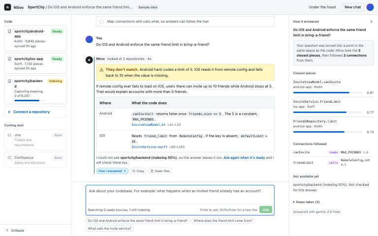

# Ntivo

Ntivo is the team's guru as a service. It reads your codebases once, then answers questions about how the product actually works, across repositories, in plain English, with the exact code cited.

It is the one engineer who has read every repo, except it never leaves and anyone can ask it. Open source, Kotlin-native, self-hosted. Code is indexed on your machine with a local model; only the few pieces a question needs go to the answer model. Today it reads code. Tickets, docs and logs can join the same space later.



_The screenshot uses the built-in sample data (`/?mock=1&scenario=1`). The same screens were exercised against real repositories (JakeWharton/timber and onevcat/Rainbow): a cross-repository question returned seven validated citations from Kotlin and Swift files._

Ask things like:

- *"Do iOS and Android enforce the same friend limit in bring-a-friend?"*
- *"What happens when an invited friend already has an account?"*
- *"Which functions call this one, and in which app?"*

Each answer takes a position, shows one evidence row per platform with the file and line range, and says what it could not see, such as a repository that is still being read.

---

## Status

Wave 1 of the demo UI is done. You can connect a repository, watch it being read, ask a cross-repository question and see how the answer was produced. Kotlin and Swift are supported.

Wave 2 is next: Ruby, TypeScript/JavaScript, zip upload, paste, an LLM-graded eval and a GitHub App connection. After that come Jira, Confluence and Datadog as sources.

Follow along on the [blog](https://ntivo.hashnode.dev).

---

## Run it

You need JDK 21, Docker Desktop, [Ollama](https://ollama.com) and an Anthropic API key ([console.anthropic.com](https://console.anthropic.com)).

```bash
# 1. Start Neo4j and Qdrant
docker compose up -d

# 2. Start Ollama and fetch the embedding model (once)
brew install ollama
brew services start ollama
ollama pull qwen3-embedding:0.6b

# 3. Start the server (builds the developer console too)
export NTIVO_ANTHROPIC_API_KEY="your-key"
./gradlew :server:run

# 4. Open the app
open http://localhost:8080
```

The server listens on `127.0.0.1` only. There is no auth yet, so it is not reachable from other machines.

The app is static HTML, CSS and JavaScript served by Ktor, with no build step. Add `?mock=1` to the URL to try the interface with sample data and no server. The older developer console lives at `/under-the-hood/`.

For hot reload on the developer console, `./dev.sh` starts Docker, the server and the Compose dev server together.

### Environment

| Variable | Purpose | Default |
|---|---|---|
| `NTIVO_ANTHROPIC_API_KEY` | Answers with Claude Sonnet 5.5 | none; without it (and without a Gemini key) questions are disabled |
| `NTIVO_GEMINI_API_KEY` | Answers with Gemini 2.5 Flash when no Anthropic key is set; embeddings when `NTIVO_EMBEDDER=gemini` | none |
| `NTIVO_EMBEDDER` | `ollama` (local) or `gemini` | `ollama` |
| `NTIVO_OLLAMA_URL` | Ollama server | `http://localhost:11434` |
| `NTIVO_OLLAMA_EMBED_MODEL` | Ollama embedding model | `qwen3-embedding:0.6b` |
| `NTIVO_NEO4J_URI` | Neo4j Bolt address | `bolt://localhost:7687` |
| `NTIVO_NEO4J_PASSWORD` | Neo4j password | `ntivo_dev_password` |
| `NTIVO_QDRANT_HOST` | Qdrant host (gRPC port 6334) | `localhost` |
| `NTIVO_DATA_DIR` | Where sources, working copies and traces live | `data/` at the repo root |

---

## Connect a repository

Choose "Connect a repository" in the left column. Two ways work today:

1. **GitHub URL.** Paste the repository URL, optionally a branch, and a personal access token for a private repository. Ntivo makes a shallow clone.
2. **Upload a folder.** Pick a local folder. The dialog shows the file count and total size before you connect, so you can decide whether a whole codebase or one module fits.

Either way a card appears in the chat and walks through four steps:

1. Fetch the files.
2. Split them into pieces, one per function or method, so answers point at the exact code.
3. Capture meaning, so you can search by what code does instead of what it is called.
4. Map connections: who calls what, so answers can follow the trail.

Indexing time is shown per step. Capturing meaning dominates and runs locally: JakeWharton/timber (217 functions) took 14 seconds on an M4 Pro, so a mobile app with a few thousand functions takes minutes. Unchanged functions are skipped when a repository is indexed again. A repository with no Kotlin or Swift files ends in a failed state with "No Kotlin or Swift files found".

---

## Guardrails

The agent is non-deterministic and reads untrusted text, so the limits are part of the build. Every answer is structured, and the server drops any citation to code the agent did not actually retrieve. Search results below a similarity cut-off never reach the model; the cut-off is set per embedding model (0.45 for the local Qwen3 model, 0.60 for Gemini). A question gets at most 6 tool calls, graph queries stop at 3 hops and 50 results, and the whole question has a 60 second budget. The model is pinned in code. Gemini runs at temperature 0.2; Claude only accepts its default, so it relies on the prompt and the structured answer format instead. Tools are read-only. Repository code reaches the model inside delimited data blocks and is treated as data, never as instructions, and obvious secrets are redacted before anything is stored. A GitHub token you enter stays in server memory and is never logged or written to disk. Sources that are still indexing or failed are listed as "could not see" in the answer, from server state rather than the model's memory. Every question keeps a trace, shown under "How I answered".

---

## Demo scenario

The demo shows iOS and Android drift on the bring-a-friend friend limit, using two real repositories.

1. Connect the Android repository, by GitHub URL with a token or as a local folder.
2. Connect the iOS repository the other way, so both connect methods are on show.
3. Watch both cards finish their four steps.
4. Ask: *Do iOS and Android enforce the same friend limit in bring-a-friend?*
5. Read the verdict, the evidence row per platform and the cited files. Click a citation to open the code with the cited lines highlighted.
6. Open "How I answered" to see the closest pieces with similarity scores and the connections followed.
7. Connect a third repository and ask again while it indexes. The answer names it under "could not see".

Eval baseline: not yet recorded. To record it, connect this repository as a source, then run:

```bash
./gradlew :server:runEval -x :server:copyWebDist
```

Paste the three aggregate numbers it prints here.

---

## Tests and eval

```bash
./gradlew :server:test -x :server:copyWebDist   # No API key needed; Qdrant and Neo4j tests skip when unreachable
./gradlew :server:runEval -x :server:copyWebDist   # Needs a running server with this repo connected
```

`eval/questions.json` holds the question set with expected pieces and facts. The runner reports retrieval precision and citation validity and keeps each run under `data/eval-runs/`, so changes can be compared.

---

## Tech stack

| Component | Technology |
|---|---|
| Language | Kotlin |
| Backend | Ktor |
| AI agents | [Koog](https://github.com/JetBrains/koog) (JetBrains, Apache 2.0) |
| Answer model | Claude Sonnet 5.5 (Gemini 2.5 Flash as an alternative) |
| Code graph | Neo4j |
| Vector store | Qdrant |
| Code parsing | Tree-sitter (JVM bindings), Kotlin and Swift |
| Embeddings | Local: Ollama with `qwen3-embedding:0.6b`. Gemini `gemini-embedding-001` as an alternative |
| App | Static HTML, CSS and JS, no framework |
| Developer console | Compose for Web (Kotlin/Wasm) at `/under-the-hood/` |
| Build | Gradle (Kotlin DSL), JDK 21 |

---

## Roadmap

- [x] Stack foundation: Ktor, Koog, Gemini, Qdrant, Neo4j, Tree-sitter
- [x] Connect a repository by GitHub URL or folder upload, with live four-step indexing
- [x] Kotlin and Swift parsing, code graph with confidence on every edge
- [x] Grounded answers with validated citations, a trace and guardrails
- [ ] Ruby and TypeScript/JavaScript, zip upload, paste
- [ ] LLM-graded eval
- [ ] GitHub App connection
- [ ] Jira, Confluence and Datadog as sources
- [ ] MCP server for Cursor, Claude and other AI clients

---

## Self-hosting

Self-hosted from day one. Bring your own model key. Indexing runs on your machine, so whole repositories never leave it. Each question sends the pieces of code it retrieved (a handful of functions) to the answer model. If you switch to Gemini, use the paid tier so repository text is not used for training. Local-only for now: no auth, and the server listens on `127.0.0.1`.

---

## Contributing

Too early for outside contributions. Watch the repo or follow the [blog](https://ntivo.hashnode.dev) to know when it is ready.

---

## License

Apache 2.0

## Name

*Ntivo* comes from the Xitsonga root word for "knowledge" (*ntivo*), as in *vutivi*.
